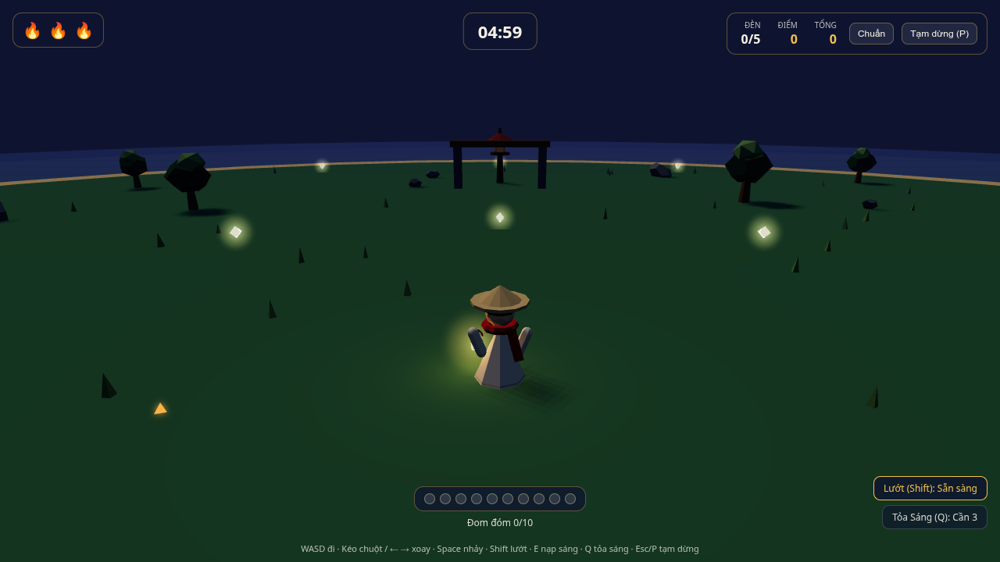

# Đảo Đèn Lồng · v1.0.0 (Contract v1.3)

> **Video demo**: [docs/demo/demo.mp4](docs/demo/demo.mp4)

Game hành động 3D góc nhìn thứ ba bằng **JavaScript, Vite và Three.js (WebGL 2)** với lõi mô phỏng cố định **60 tick/giây** dùng chung cho trình duyệt và CLI headless (Test Contract v1.3). Người chơi điều khiển Mây đi qua 3 hòn đảo (**Đảo Bến**, **Đảo Cau**, **Đảo Chuông**), thu thập đom đóm, thắp và châm dầu cho Đèn Lồng Lớn để giữ đảo sáng tới bình minh.



## Yêu cầu hệ thống

- **Node.js** `>= 20` và **npm**
- Trình duyệt hỗ trợ **WebGL 2** (Chrome / Chromium / Edge / Firefox bản hiện đại)
- Python 3 (tùy chọn, để chạy harness `scripts/verify-headless.py`)

## Cài đặt và chơi (3 lệnh)

```sh
npm ci
npm run build
node scripts/run.js
```

Launcher sẽ phục vụ bản build tĩnh tại địa chỉ loopback `http://127.0.0.1:<port>/` và tự mở trình duyệt. Có thể chuyển **Chuẩn / Nhẹ** ở góc trên phải, hoặc mở **Cài đặt** để chỉnh âm lượng, độ nhạy chuột, đổi phím, **Bảng màu dễ phân biệt**, **Giảm chuyển động** và **Chữ lớn (×1.25)**.

## Điều khiển mặc định (có thể đổi trong Cài đặt)

| Phím / Thao tác | Hành động |
| --- | --- |
| `W A S D` / `↑ ↓` | Di chuyển Mây theo hướng camera (6.0 m/s, 7.2 m/s khi có Bùa Gió) |
| Kéo chuột hoặc `← →` | Xoay camera quanh Mây |
| `Space` | Nhảy tại mặt đỡ (7.0 m/s, trọng lực −20 m/s²) |
| `Shift` | Lướt (14 m/s trong 0.2 s, hồi 1.5 s; bỏ qua hồi chiêu khi có Bùa Gió) |
| `E` | Nạp đom đóm thắp đèn (10 lần đầu / 5 thắp lại) hoặc châm dầu (+10 dầu/đom đóm, tối đa 100) |
| `Q` | Tỏa Sáng (tốn 3 đom đóm, bán kính 3D 5 m, hồi 3 s, choáng 120 tick & đẩy 4 m) |
| `Esc` / `P` | Tạm dừng / Tiếp tục |

## Luật chơi & Cách tính điểm

- **Giữ sáng đến bình minh**: Đêm 1 / 2 / 3 kéo dài **240 / 270 / 300 giây**. Giữ tối thiểu **60%** số đèn sáng tại tick bình minh (**3/5**, **4/6**, **5/7**) để thắng (`dawn_survived`).
- **Nhiên liệu & Bóng Mực hút dầu**: Đèn sáng bắt đầu với `100` dầu, tự hao `1/giây`. Dưới `30` dầu, đèn nhấp nháy `1 Hz` và mất vùng an toàn; Bóng Mực `wander` có thể áp sát `drain` hút `5 dầu/giây`.
- **Sức chứa động**: Khởi điểm `10`, tăng `+2` sau mỗi lần thắp thành công trong đêm (tối đa `20`).
- **Điểm**: **+5** mỗi đom đóm nạp/châm · **+100** thắp lần đầu · **+40** thắp lại · **+5** mỗi Bóng Mực trúng Tỏa Sáng (**+15** nếu đang `drain`) · thưởng bình minh khi thắng: **+50 + floor(fuel)** mỗi đèn đang sáng + **+50** mỗi Ngọn Lửa còn lại.

## Test, Headless, Benchmark, Soak & Bảng xếp hạng

```sh
# 1. Unit & regression tests (33/33)
npm test

# 2. Chạy headless CLI & đối chiếu tất định
node scripts/headless.js --night 1 --seed 42 --ticks 120 --out /tmp/smoke.jsonl
python3 scripts/verify-headless.py --night 1 --seed 42 --ticks 200 --scenario tests/fixtures/p3-lifecycle-scenario.json --inputs tests/fixtures/p3-interact-inputs.json --out /tmp/p3-life.jsonl

# 3. Benchmark 1280x720 (200 Bóng Mực + 100 đom đóm, 3s warmup + 30s đo)
node scripts/bench.js --seed 42 --duration 30 --out bench.json

# 4. Soak test 10 Đêm liên tiếp trong cùng tiến trình Node.js
node scripts/soak.js --seed 7 --nights 10 --out soak.json

# 5. Xuất Bảng xếp hạng cục bộ (Top 10)
node scripts/run.js --export-leaderboard out.json
```

> **Ghi chú benchmark trình duyệt**: `scripts/bench.js` khởi chạy Chrome/Chromium với `--disable-gpu-vsync` (trên một số trình quản lý cửa sổ Linux/Wayland, compositor có thể vẫn giữ VSync ở mức hiển thị) và đo `peak_mem_mb` từ `/proc/<pid>/status` (`VmHWM`) trên Linux (trả `null` trên hệ điều hành không có `/proc`).

## Tài liệu & Bằng chứng

- Nhật ký & giả định: [WORKLOG.md](WORKLOG.md)
- Retro 4 phase: [docs/retro-4-phases.md](docs/retro-4-phases.md)
- ADR & Changelog: [docs/adr/0001-lantern-fuel-and-dawn.md](docs/adr/0001-lantern-fuel-and-dawn.md) · [CHANGELOG.md](CHANGELOG.md)
- Credits & Giấy phép: [CREDITS.md](CREDITS.md) · [LICENSE](LICENSE)
- Hợp đồng & số đo gốc: [game.contract.json](game.contract.json) · [bench.json](bench.json) · [soak.json](soak.json)
- Bằng chứng từng phase: [Phase 1](docs/proof/phase-1/) · [Phase 2](docs/proof/phase-2/) · [Phase 3](docs/proof/phase-3/) · [Phase 4](docs/proof/phase-4/)
